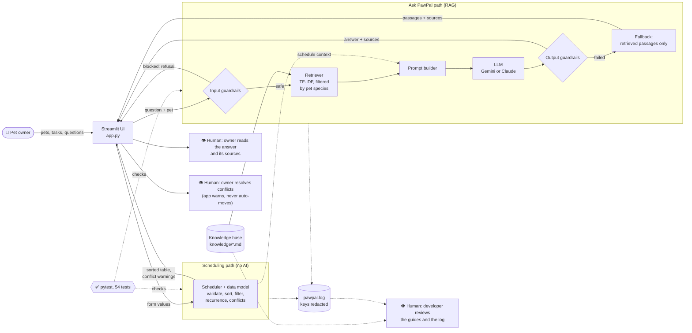

# PawPal+ System Diagram

PawPal+ has two paths through the same app: a **scheduling path** (tasks, sorting, recurrence, conflicts) that is plain deterministic Python, and an **Ask PawPal path** that uses retrieval-augmented generation (RAG). Both are checked by tests, by guardrails and by the owner.

## How data flows

| Step | Input | Process | Output |
|------|-------|---------|--------|
| 1. Manage pets and tasks | Form values from the owner | Validate, store in `Owner` / `Pet` / `Task`, then `Scheduler` sorts, filters, creates recurring copies and finds overlaps | Sorted schedule table and conflict warnings |
| 2. Ask a question | Question text and the selected pet | Clean the text, block suspicious questions, retrieve the best guide sections for that species, add the pet's schedule, ask the LLM | Written answer with sources |
| 3. When the AI is unavailable | Same question | The retrieved passages are shown directly | Answer made only of guide text, with a note |

## Where humans and tests check the AI

- **Retrieval quality:** tests assert that each species' questions find the right guide section and that a rabbit never receives dog or cat advice.
- **Guardrails:** tests cover blocked injection attempts, empty or oversized model replies, model failures falling back safely, and API keys being redacted from logs.
- **Grounding:** the prompt tells the model to use only the retrieved passages and the schedule, and every answer shows its sources, so the owner can verify it.
- **Owner:** reads the answer and sources, and resolves schedule conflicts. The app only warns.
- **Developer:** reviews the guides in `knowledge/` and `pawpal.log` for blocked or failed questions. There is no automated scoring of answer quality, so a person has to judge whether answers are good.
- **Safety net:** the general guide tells owners to call a vet in emergencies, and the model is told to suggest a vet when the guide does not cover a question.
