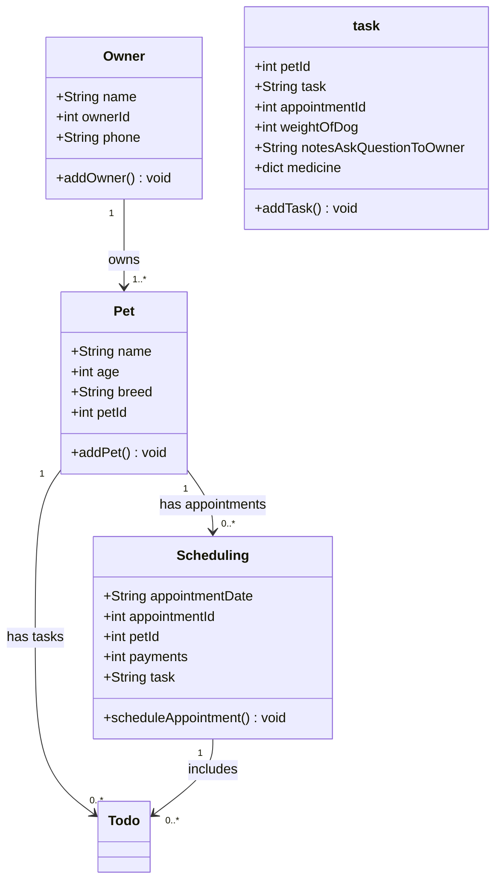

# PawPal+ Project Reflection

## 1. System Design

**a. Initial design**

- Briefly describe your initial UML design.
The reason why i added three classes is because each part plays a big role. One is adding the pet because we want to know the information about the pet in order for us to know what medication the pet can take depending on the pet itself. The second is scheduling because the owner needs to know what day are available and if its urgent or not. Second is todo/task: Any concern about the dog that the owner want us to know or what the owner should hear about our best option of taking care of the dog. And give its medication description and how much it cost and how many the dog should take every single day.

1. add a pet.
    1. name of the pet: string
    2. age: int 
    3. breed: string
    4. petId: int
2. scheduling:
    1. appointment date: string
    2. appointmentID: int
    3. petId: int
    4. payments: int
    5. Task: string
3. task:
    1. petId: int
    2. Task: string
    3. appointmentId: int
    4. weight_of_dog: int
    5. notes_ask_question_to_the_owner: string
    6. medicine: dict
4. owner:
    1. owner: name
    2. owner_pet_name: name
    3. owner_id: int

- What classes did you include, and what responsibilities did you assign to each?
i added four classes, which are add pet, scheduling , task , and owner. add_pet responsibility is getting the information about the pet, scheduling class responsible for scheduling the appointment for the owner, and task class is for what the owner is consider about the dog , and what medication dog needs, and lastly is the owner class, information about the owner relationship to the dog. 

**b. Design changes**

- Did your design change during implementation?
- If yes, describe at least one change and why you made it.

My design did change and gave me explanations as to why i should add this in the design. One was in my scheduler class of adding a issue they find in the dog. Like any medical attention the dogs need.  

---

## 2. Scheduling Logic and Tradeoffs

**a. Constraints and priorities**

- What constraints does your scheduler consider (for example: time, priority, preferences)?
- How did you decide which constraints mattered most?

**b. Tradeoffs**

- Describe one tradeoff your scheduler makes.
- Why is that tradeoff reasonable for this scenario?

---

## 3. AI Collaboration

**a. How you used AI**

- How did you use AI tools during this project (for example: design brainstorming, debugging, refactoring)?
- What kinds of prompts or questions were most helpful?

**b. Judgment and verification**

- Describe one moment where you did not accept an AI suggestion as-is.
- How did you evaluate or verify what the AI suggested?

---

## 4. Testing and Verification

**a. What you tested**

- What behaviors did you test?
- Why were these tests important?

**b. Confidence**

- How confident are you that your scheduler works correctly?
- What edge cases would you test next if you had more time?

---

## 5. Reflection

**a. What went well**

- What part of this project are you most satisfied with?
The part i am most satisfied with is the opinion AI suggest for me to add because it gives a clear indications as why i should implement this instead of other stuff that arent necessary. 

**b. What you would improve**

- If you had another iteration, what would you improve or redesign?
I would redesign the UML design more because there are more stuff need to be added. And removing somethings that i believe theres a better way to do it.

**c. Key takeaway**

- What is one important thing you learned about designing systems or working with AI on this project?

One important key thing i learn about designing systems is making connections with each other because you need to know the relationship between all classes and function to each other. It way harder than it looks. 
